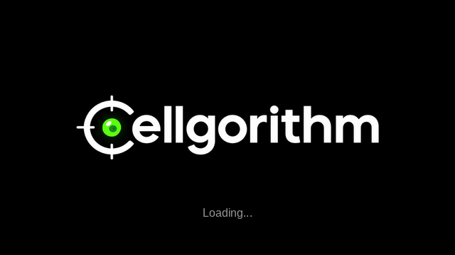

<p align="center"></p>

# Cellgorithm — Hemocytometer Cell Counting Program

혈구계수판(hemocytometer) 현미경 이미지에서 세포를 자동으로 계수하고, Trypan blue 염색 기반으로 생세포와 사세포를 판별하는 프로그램입니다. 미세조류와 출아 효모 계수도 지원합니다.

An image analysis program that automatically counts cells in hemocytometer images and classifies live/dead cells stained with Trypan blue. Microalgae and budding yeast are also supported.

## 다운로드 (Download)

**[Releases](../../releases/latest)** 에서 `Cellgorithm.exe` 를 내려받아 실행하면 됩니다 (Windows, 설치 불필요).

Download `Cellgorithm.exe` from **[Releases](../../releases/latest)** and run it (Windows, no installation needed).

> 처음 실행 시 Windows SmartScreen 경고가 뜨면 "추가 정보 → 실행"을 누르세요.

## 사용 방법 (Usage)

1. 프로그램을 실행합니다.
2. 계수할 대상(Cells / Microalgae / Yeast)을 선택합니다.
3. 혈구계수판 이미지를 불러와 분석을 실행합니다.
4. 사분면별 계수 결과, 생존율, 세포 농도를 확인합니다.

## 소스 코드로 실행 (Run from source)

```bash
pip install -r requirements.txt
python Cellgorithm.py
```

## exe 직접 빌드 (Build the exe)

Windows에서 `build.bat` 을 실행하면 `dist/Cellgorithm.exe` 가 만들어집니다.

## Contact

Nano-Enabled Agriculture and Biosystems Engineering Laboratory, Pusan National University
